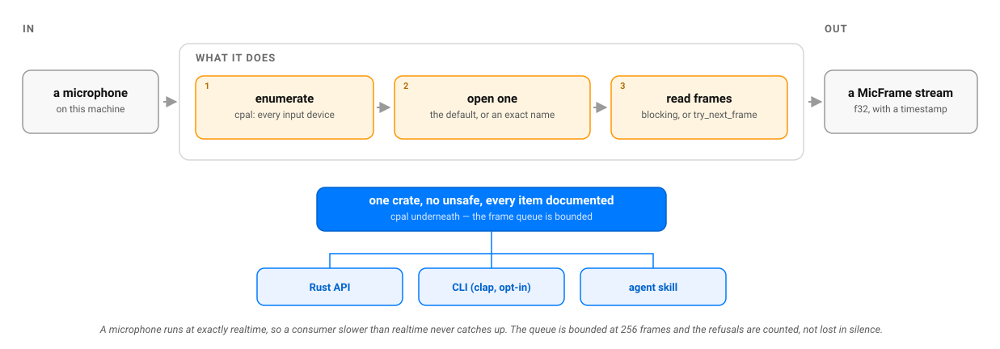

# Capture Helper (Rust)

[🇫🇷](https://github.com/warith-harchaoui/capture-helper-rs/blob/main/LISEZMOI.md) · [🇬🇧](https://github.com/warith-harchaoui/capture-helper-rs/blob/main/README.md)

[](https://crates.io/crates/capture-helper-rs) [](./LICENSE)

Rust rewrite of the microphone half of [`capture-helper`](https://github.com/warith-harchaoui/capture-helper): turn a live microphone into a stream of small audio packets (PCM) that the rest of an audio pipeline can consume, with no third-party service in the loop.

This is not a line-by-line port. The camera half of the original (`iter_camera_frames`, the multi-source scene GUI, video mixing) is out of scope for v0.1 — only the microphone is covered.

## What this crate does (v0.1)

- `list_input_devices() -> Result<Vec<String>, CaptureHelperError>` — enumerates the system's audio input devices via [`cpal`](https://crates.io/crates/cpal). An empty list is an honest answer (no microphone plugged in); only a real host enumeration failure returns an error.
- `default_input_device_name() -> Option<String>` — which microphone `MicCapture::from_default_device()` would open, without opening it. `None` is the ordinary state of a headless machine, not a failure. For display only: the name is not guaranteed to appear in `list_input_devices()` (on ALSA it does not), so open the default with `from_default_device()` rather than by passing this name to `from_named_device()`.
- `MicCapture` — opens a microphone stream (default or named device) and exposes it as an iterator of `MicFrame`: blocking via `for frame in &mic { ... }` / `next_frame()`, or non-blocking via `try_next_frame()`. Iterating by reference keeps the handle, so `mic.error()` can still say why the stream ended; iterating by value gives that answer away with the handle.
- `MicCapture::error() -> Option<String>` — the device error that ended the capture, if one did. `cpal` reports stream failures through a callback with no path back to the caller, so the message is handed back here rather than printed to stderr. A failed stream ends iteration instead of blocking it (fixed in 0.1.2).
- `MicFrame { samples: Vec<f32>, sample_rate: u32, channels: u16, timestamp: Instant }` — a PCM packet normalized to `f32` in `[-1.0, 1.0]`, regardless of the device's native sample format (`f32`, `i16`, `u16`).
- `CaptureHelperError` (via `thiserror`) — one variant per failure mode: no default device, named device not found, enumeration failure, stream-config failure, unsupported sample format, stream-build failure, stream-start failure. No catch-all `String`.

## What this crate does not do (yet, or at all)

- No camera, no images, no GUI — that half of the Python original stays there.
- No resampling, no mono/stereo conversion, no voice-activity detection: `MicFrame` delivers exactly what the device gives, normalized to `f32`, nothing more.
- No device selection by index or name substring (exact name or default device only).

## How it works



## Example

```rust
use capture_helper_rs::{default_input_device_name, list_input_devices, MicCapture};

fn main() -> Result<(), Box<dyn std::error::Error>> {
    for name in list_input_devices()? {
        println!("input device: {name}");
    }
    println!("default: {:?}", default_input_device_name());

    let mic = MicCapture::from_default_device()?;
    for frame in (&mic).take(50) {
        println!("{} samples @ {} Hz, {} channel(s)", frame.samples.len(), frame.sample_rate, frame.channels);
    }

    // The loop ends either because you stopped asking or because the device
    // failed. This is how you tell which.
    if let Some(err) = mic.error() {
        eprintln!("capture stopped: {err}");
    }

    Ok(())
}
```

## Test coverage — read before trusting CI

This environment (and probably yours) has no real microphone attached. Concretely:

- `list_input_devices()` **is** tested: it must always return a `Vec` (possibly empty) without panicking.
- Error paths reachable without hardware **are** tested: asking for a named device that clearly doesn't exist must produce `CaptureHelperError::DeviceNotFound` (or `DeviceEnumeration` if the host has no audio subsystem at all).
- Actually capturing a stream (`MicCapture::from_default_device()` receiving real samples, or `from_named_device()` on a name that truly exists) **is not tested in CI** — it needs a physical microphone and an OS permission grant. No test in this repository claims to verify that path; it's a manual check to run on a machine with a microphone before relying on it in production.

## Command line

`cargo install capture-helper-rs` also installs a `capture-helper-rs` binary — named after the
crate, not after the Python twin's `capture-helper`, so the two coexist on one `PATH`
without either silently shadowing the other.

```bash
capture-helper-rs devices
capture-helper-rs record session.wav --seconds 30
capture-helper-rs record session.wav --seconds 30 --pcm16
```

Success prints the result on stdout and exits `0`; failure prints one line on
stderr, prefixed `capture-helper-rs: `, and exits `1`. Every flag and every failure mode:
[`skills/capture-helper-rs/references/cli-reference.md`](skills/capture-helper-rs/references/cli-reference.md).

## Agent skill

`skills/capture-helper-rs/` packages this crate as a **Claude Skill** and an **OpenCode
skill**, so an agent can discover it and use it on the user's behalf.
Installation for both hosts is in [`skills/README.md`](skills/README.md).

Its trigger catalogue is enforced, not decorative: [`TRIGGERS.md`](TRIGGERS.md)
is the user-facing catalogue, `references/triggers.md` is its agent-facing
mirror, and `tests/skill.rs` fails `cargo test` — and therefore the pre-push
hook — if the two drift apart, if the skill's `description` exceeds the
published 1024-character cap, if its `name` stops matching its folder or if it
points at a reference that no longer exists.

## When the consumer falls behind

A microphone produces audio at exactly realtime, so a consumer even slightly
slower than realtime never catches up. The frame queue is therefore **bounded**
(256 frames), and frames that do not fit are refused and counted:

```rust
let capture = MicCapture::from_default_device()?;
// ... consume frames ...
if capture.dropped_frames() > 0 {
    eprintln!("{} frames lost — the consumer is slower than the mic", capture.dropped_frames());
}
```

With an unbounded queue this is not a slowdown but a leak: the backlog grows
for as long as capture runs, with no error and no warning. A bound turns that
into bounded memory plus a number you can read. Audio is lost either way once a
consumer falls behind — being told is the difference between a pipeline that is
lossy and one that is lossy *without anyone knowing*.

Zero is the normal reading. A clean shutdown (dropping `MicCapture`
mid-callback) is a disconnected receiver, not backpressure, and is never
counted.

## Project status

Coverage measured with [`cargo-llvm-cov`](https://github.com/taiki-e/cargo-llvm-cov), re-measured 2026-10-02 for 0.1.2, on macOS (LLVM tools via Xcode):

| File | Line coverage |
|---|---|
| `src/error.rs` | 100.00% |
| `src/devices.rs` | 92.59% |
| `src/capture.rs` | 44.57% |
| **Total** | **53.36%** (223 lines, 104 uncovered) |

`capture.rs` roughly tripled in 0.1.2: the stream-failure plumbing it gained is deliberately free-standing, so it is testable without a microphone. What stays uncovered is the part that genuinely needs one — see the section above.

The overall figure is low because most of the uncovered code in `capture.rs` is exactly the path described above (building and reading a real `cpal` stream): it cannot be exercised without a physical microphone, and this crate does not fake a device just to inflate a percentage. `error.rs` and `devices.rs` — the code reachable without hardware — sit at 92–100%.

To reproduce:

```bash
cargo install cargo-llvm-cov
# macOS without rustup: point at Xcode's LLVM tools
export LLVM_COV=$(xcrun --find llvm-cov)
export LLVM_PROFDATA=$(xcrun --find llvm-profdata)
# with rustup (Linux/Windows/macOS): rustup component add llvm-tools-preview

cargo llvm-cov --summary-only
```

## Opening the microphone on the system's own path

There is no accelerator to pick here, and it is worth saying that plainly instead of inventing
one: capture is not compute. The audio arrives at exactly real time whatever the hardware, and
the only thing that can be wrong is the *path* it travels. That path is the device's own
default configuration, which is what this crate opens:

- **The native host** — CoreAudio on macOS, WASAPI on Windows, ALSA (and through it PulseAudio
  or PipeWire) on Linux. No PortAudio, no `ffmpeg`, nothing extra to install.
- **The device's own rate and format.** Ask a 48 kHz microphone for 16 kHz and the operating
  system inserts a resampler you did not choose, in a layer you cannot see, before you receive
  a single sample. Opening the device's rate skips it; resampling afterwards is at least yours
  and visible.
- **The driver's own buffer size** — the compromise the platform chose between latency and
  wake-ups.

What is configurable is exactly those three, because "best for this machine" is not "best for
every use": live transcription wants a small fixed buffer, a long unattended recording wants a
large one.

```sh
capture-helper-rs record out.wav --seconds 10 --sample-rate 48000 --buffer-frames 256
capture-helper-rs record out.wav --seconds 10 --host coreaudio --device "Yeti Nano"
CAPTURE_HELPER_SAMPLE_RATE=48000 capture-helper-rs record out.wav --seconds 10
```

```rust
let mic = MicCapture::from_options(&CaptureOptions {
    sample_rate: Some(48_000),
    buffer_frames: Some(256),
    ..Default::default()
})?;
```

A field set in code beats the environment; the environment is for pinning a machine, not for
overruling a caller who was specific.

**A rate the device cannot produce is an error, not a quiet resample.** The message names what
the device does offer. A hidden resampler on the capture path is how a recording ends up subtly
worse than its source with nothing in the logs to say so. A *buffer* request is clamped
instead, because it changes timing rather than data, and the driver is entitled to the last
word on that.

## Installation

```toml
[dependencies]
capture-helper-rs = "0.2"
```

Requires Rust 1.85 or newer. `cpal` handles CoreAudio (macOS), WASAPI (Windows), and ALSA/PulseAudio/JACK/PipeWire (Linux) natively — no separate `ffmpeg`/`PortAudio` install needed.

## Checks before pushing

```bash
scripts/install-hooks.sh   # once per clone: installs the pre-push gate below
cargo fmt --all --check
cargo clippy --all-targets -- -D warnings
cargo test --all
scripts/check-fresh-resolve.sh   # builds with no Cargo.lock, like a downstream consumer
```

The last one exists because the other three, and CI, all build against the committed
`Cargo.lock` — which no consumer of the published crate ever sees. A dependency range that
has gone bad stays green here while breaking every fresh `cargo add` / `cargo install`, and
`cargo publish --dry-run` doesn't catch it either (it verifies with the same lock). CI runs
this check once, on Linux.

## Related

Part of the same author's local-first tooling as [`capture-helper`](https://github.com/warith-harchaoui/capture-helper) (Python) and the [AI Helpers](https://github.com/warith-harchaoui/ai-helpers) suite. Independent rewrite, not a binding.

## Author

- [Warith HARCHAOUI](https://linkedin.com/in/warith-harchaoui)

## License

BSD-3-Clause — see [LICENSE](./LICENSE).
